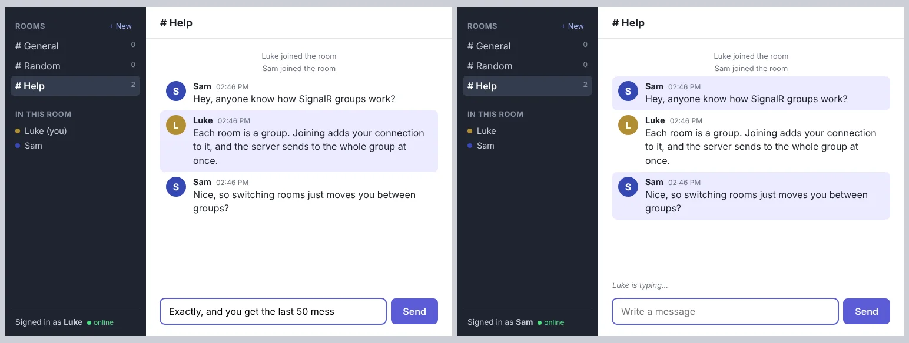

# Realtime Chat

A multi-room chat app built with ASP.NET Core and SignalR. Messages, the list of who's online and typing indicators all update instantly for everyone in the room, without refreshing.



## Features

- Rooms: three default rooms, plus create your own (custom rooms are cleaned up when the last person leaves)
- Live list of who's in the room and how many people are in each room
- "Sam is typing…" indicator, throttled so it doesn't send a message on every key press
- Last 50 messages are loaded when you join a room
- Unique display names, validated on the server
- Automatically reconnects and rejoins your room if the connection drops
- Messages are rendered with `textContent`, so nobody can inject HTML or scripts into other users' browsers

## Tech

- **Backend:** C#, ASP.NET Core 8, SignalR
- **Frontend:** plain HTML, CSS and JavaScript with the SignalR JS client
- **Tests:** xUnit, with integration tests that run the real app in memory using `WebApplicationFactory`
- **CI:** GitHub Actions builds and runs the tests on every push

## How it works

The browser opens a persistent connection to `/hubs/chat` (SignalR uses WebSockets when it can and falls back to other transports when it can't). Instead of the browser asking the server for new messages, the server **pushes** them.

`ChatHub` is the class the browser calls into: `Join`, `SendMessage` and `Typing`. Each room is a SignalR **group**, so sending to a room is one call:

```csharp
await Clients.Group(member.Room).ReceiveMessage(message);
```

The hub is strongly typed with an `IChatClient` interface, so a typo in a client method name is a compile error instead of a silent bug.

SignalR creates a new hub instance for every call, so anything that needs to stick around (who's connected, which room they're in, message history) lives in `ChatState`, registered as a singleton. It uses a lock because many connections can call into it at the same time.

All input is validated on the server, since anyone can call the hub directly without going through the page. Errors are thrown as `HubException`, the only exception type whose message SignalR passes back to the client.

## Running it locally

Requires the [.NET 8 SDK](https://dotnet.microsoft.com/download/dotnet/8.0).

```bash
dotnet run --project src/RealtimeChat
```

Open the URL it prints (http://localhost:5196 by default) in two browser tabs and chat between them.

Run the tests with:

```bash
dotnet test
```

## Project structure

```
src/RealtimeChat/
  Program.cs            app setup and hub route
  Hubs/ChatHub.cs       hub methods the browser calls
  Chat/ChatState.cs     connected users, rooms, history and validation
  Chat/ChatMessage.cs   message and join result records
  wwwroot/              the chat page (HTML, CSS, JS)
tests/RealtimeChat.Tests/
  ChatStateTests.cs     unit tests for rooms, names and history
  ChatHubTests.cs       end-to-end tests over a real SignalR connection
```

## Limitations and next steps

- Everything is in memory, so history is lost on restart. Next step would be saving messages to a database with Entity Framework Core.
- No accounts or passwords, just a display name.
- Running more than one server instance would need a SignalR backplane (like Redis) so messages reach users on every instance.

## Credit

Inspired by Adam La Morre's realtime chat tutorials ([Node](https://www.youtube.com/watch?v=Fzv-rgwcFKk), [Python](https://www.youtube.com/watch?v=YDZPp0EnzEA)). Those use a hosted chat service for the real-time part. I wanted to build that part myself, so this version uses SignalR and C# instead.
